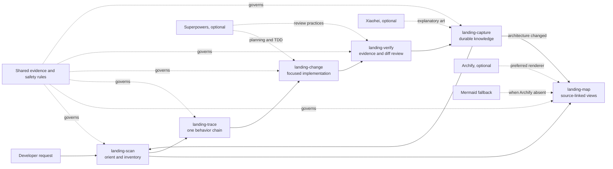

# S6 developer self-scan result

Date: 2026-10-22

Repository: `landing-kit` working tree

Host: Codex development session

Prompt: “Use Landing Kit to validate its own structure and map its Skill lifecycle.”

## Scope and caveat

This is a real repository self-test of the workflow and artifacts, not an independent host-installation or automatic-trigger test. The development conversation already contained `DEVELOPMENT.md`, so it cannot measure cold-start discovery. Codex and Claude marketplace installation remain unverified.

## Scan findings

- Purpose: a portable six-Skill workflow for unfamiliar-codebase onboarding and safe development, supported by [README.md](../../README.md) and [DEVELOPMENT.md](../../DEVELOPMENT.md).
- Runtime shape: instruction/plugin repository rather than an application server. Core artifacts are Markdown Skills, JSON plugin manifests, YAML UI metadata, and one standard-library Python validator.
- Entry points: root [plugin.json](../../plugin.json), [.codex-plugin/plugin.json](../../.codex-plugin/plugin.json), [.claude-plugin/plugin.json](../../.claude-plugin/plugin.json), and the six `skills/*/SKILL.md` files.
- Shared contracts: [evidence-and-safety.md](../../references/evidence-and-safety.md), [dependencies.md](../../references/dependencies.md), [cross-platform.md](../../references/cross-platform.md), and [responsibility-contracts.md](../../references/responsibility-contracts.md).
- Verification entry point: `python3 scripts/validate_repository.py`.
- Git state: `DEVELOPMENT.md` was pre-existing and untracked; it remained unmodified. First-version implementation files were new, except the requested README expansion.

## Lifecycle map

Archify was not advertised by the active host and `mmdc` was not installed. No installation was attempted. The test therefore used the documented Mermaid fallback. The source below was reviewed but not locally rendered.

## Map evidence index

| Relationship | Evidence |
| --- | --- |
| scan → map, trace | `skills/landing-scan/SKILL.md` workflow steps 6 and 8 |
| trace → change | `skills/landing-change/SKILL.md` workflow step 2 |
| change → verify | `skills/landing-change/SKILL.md` workflow step 9 |
| verify → capture | `skills/landing-verify/SKILL.md` workflow step 10 |
| capture → map | `skills/landing-capture/SKILL.md` workflow step 6 |
| shared safety rules → all Skills | each `SKILL.md` opening instruction and `scripts/validate_repository.py` |
| optional dependency relationships | `references/dependencies.md` and the consuming Skill workflows |

The return edge `capture → scan` represents the product lifecycle documented in `DEVELOPMENT.md`; it is conceptual, not an automatic runtime invocation.

## Executed checks

| Check | Actual result |
| --- | --- |
| Skill Creator `quick_validate.py` on all six Skill folders | 6/6 passed |
| Plugin Creator `validate_plugin.py .` | passed |
| Claude Code `claude plugin validate .` | passed with non-blocking icon and unpublished-marketplace README advice |
| `python3 scripts/validate_repository.py` | passed |
| local Markdown link existence script | passed |
| `git diff --check` | passed for tracked diff |
| Mermaid render/open | not executed; no renderer present |
| Codex plugin installation and trigger | not executed |
| Claude Code plugin installation and trigger | not executed |

## Outcome

**Conditional pass.** The repository structure, Skill metadata, shared contracts, plugin compatibility manifest, local links, and self-map evidence passed the checks performed. Visual rendering, marketplace installation, automatic triggering, cross-Skill behavior in fresh sessions, and unrelated real-repository behavior remain open and are correctly listed in [STATUS.md](../../STATUS.md).
